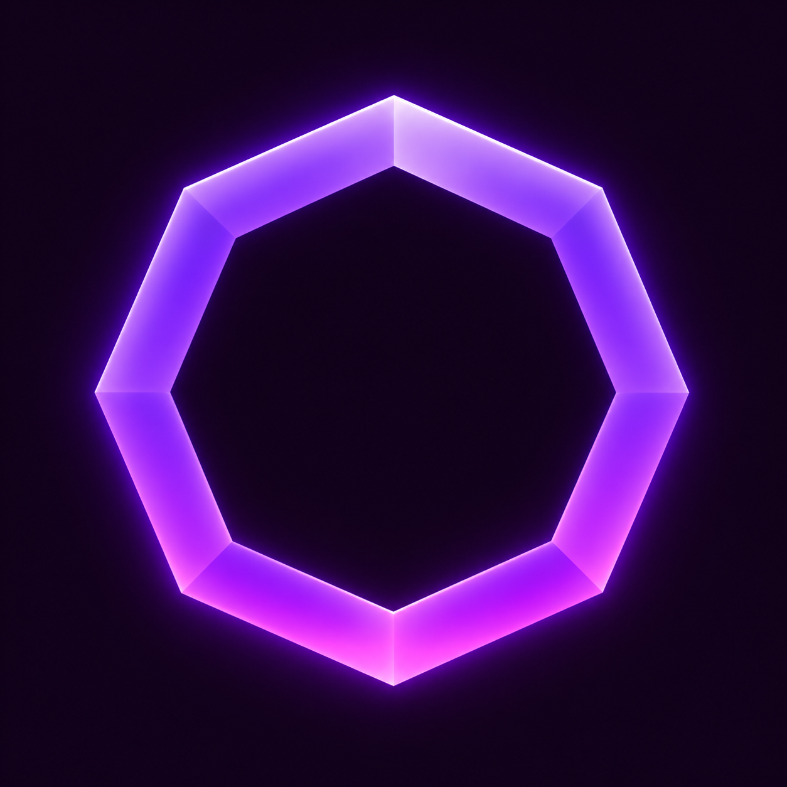
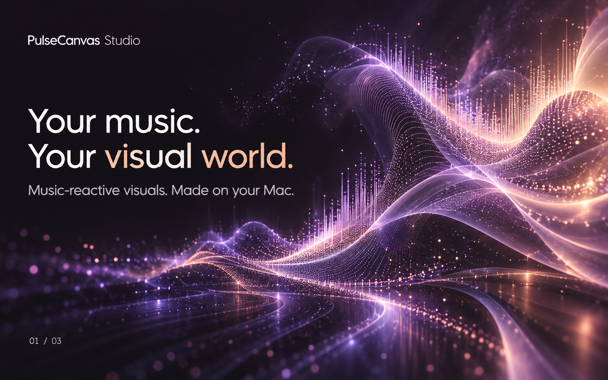
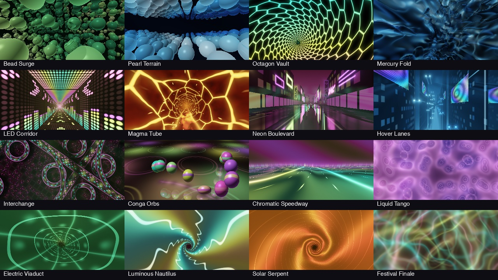
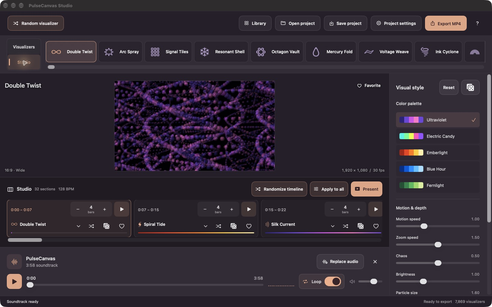

<div align="center">



# PulseCanvas Studio

### Your music. Your visual world.

**Turn a soundtrack into moving art. Made on your Mac.**

Free app · Two Mac editions · Beat-aligned scenes · Up to 4K at 60 fps

[Explore the visuals](#find-your-signature-look) · [Meet Studio](#give-your-song-a-visual-story) · [Make a video](#from-beat-to-video) · [Build the app](#build-it-on-your-mac)

</div>



<sub>Cover: conceptual campaign artwork. The interface images below are real app screenshots.</sub>

## Give your music something to look like

A tunnel that pulls you into the next drop. Liquid folds that ripple with the rhythm. A field of glowing particles that comes alive as the track builds.

PulseCanvas Studio is a native macOS visualizer and video creator. Bring a song, find a look, shape the motion, and arrange a visual journey. Then save a finished MP4 with your music—or enjoy the whole thing in full-screen presentation mode.

Make a music video, a vertical clip, a release teaser, or a backdrop for your next set. No account. No subscription. Every feature and export is free.

| 181 native visualizers | 7,838 ProjectM effects | 5 canvas shapes | Up to 4K · 60 fps |
| :---: | :---: | :---: | :---: |
| Particles, tunnels, liquid forms, and geometry | A searchable library of thousands of looks | Wide, phone, portrait, landscape, and square | MP4 video with your soundtrack |

## Find your signature look

Start with **Event Horizon**, **Ribbon Foundry**, **Chrome Metaballs**, **Octagon Vault**, or **Mercury Fold**. Explore lensed black holes, forged ribbons, liquid chrome, hyperbolic tilings, gothic naves, ferrofluid crowns, connected honeycomb tunnels, night drives, wind-farm roads, drone light shows and kinetic mirror walls. The full list is in [docs/NATIVE_VISUALIZERS.md](docs/NATIVE_VISUALIZERS.md). The direct-download edition also includes the ProjectM library for thousands more effects. The App Store edition focuses on the 181 native Metal styles.

- **Find it fast.** Search names and original creator titles, browse categories and folders, and save favorites with a heart.
- **Make it yours.** Shape motion, zoom, Chaos, brightness, blur, and camera framing. Native designs also offer color palettes and controls for their particular forms; ProjectM effects retain their own colors and structures.
- **Follow the music.** Chaos adjusts how strongly the visuals respond to the soundtrack. Turn it up for more active motion; set it to zero for smooth procedural animation without music-driven pulses.
- **Discover something unexpected.** Shuffle to another visualizer with its saved look, or roll the dice to randomize the current visual settings.



Every visualizer has a deliberate default look. Choose blue, green, warm, violet or multicolor palettes, then let your track drive waves, reflections, cells and particles.

## Give your song a visual story

**Studio** brings multiple visualizers together on a timeline. Import your soundtrack and PulseCanvas detects a beat grid for scene changes. Choose a visualizer for each section and decide how many musical bars it should play: four bars here, one bar there, two for the next moment.



| In Studio | What you can do |
| --- | --- |
| **Bars per scene** | Give each section its own length; later sections follow the beat grid. |
| **Loop a section** | Preview a scene repeatedly while you try different visualizers and styles. |
| **Use at playhead** | Assign the visualizer you are watching to the current point in the song. |
| **Randomize timeline** | Generate new visualizer assignments, bar lengths, or both. |
| **Apply to all** | Share Chaos, motion speed, zoom speed, bar lengths, and strobe choices across the video. |
| **Save your project** | Reopen your timeline and visual settings in a `.pulsecanvas` project. |

Each scene uses its visualizer’s saved appearance settings, so a look stays consistent wherever you use it. Imported audio remains linked to its original file; keep that file available when reopening a project.

## From beat to video

Choose a canvas that fits the destination. Create widescreen videos for YouTube, vertical clips for TikTok and Reels, or square posts for your feed. PulseCanvas exports the MP4; you choose where to share it.

| Canvas | Shape | Maximum export dimensions |
| --- | --- | --- |
| **Wide** | 16:9 | 3840 × 2160 |
| **Phone** | 9:16 | 2160 × 3840 |
| **Landscape** | 4:3 | 2880 × 2160 |
| **Portrait** | 3:4 | 2160 × 2880 |
| **Square** | 1:1 | 2160 × 2160 |

Choose **24, 30, or 60 fps** and a 720-, 1080-, or 2160-pixel shorter edge. Export includes the entire soundtrack as stereo AAC audio in an H.264 MP4. A live frame preview, progress bar, and estimated time keep you informed while the video renders. The file saves directly to your chosen location, with **Show in Finder** when it is ready.

Metal powers native rendering, and the encoder requests hardware acceleration where supported. Preview playback speed does not drop frames from the exported video.

## Or just press Present

Watch one visualizer full screen, or play the whole Studio timeline with automatic scene changes. Match the project’s aspect ratio or fill the display. Controls fade during playback; press **Space** to pause and **Escape** to return to the editor.

## Your first video in five steps

1. **Bring the music.** Try the bundled soundtrack, or choose **Replace audio** to import your own.
2. **Find a look.** Open **Library**, browse the effects, and heart the ones you love.
3. **Set the mood.** Adjust the visual controls or roll the dice for a fresh style.
4. **Build the journey.** In **Studio**, choose your scenes and their bar lengths—or randomize the timeline.
5. **Save the video.** Pick the canvas, resolution, and frame rate in **Project settings**, then click **Save video** and choose a destination.

Want the details? The [user guide](docs/USER_GUIDE.md) covers every control, section playback, presentation, export, and current limitations.

## Get PulseCanvas

Visit **[pulsecanvas.si](https://pulsecanvas.si/)** for the project website, or build from the source below. A dedicated [download and installation page](https://pulsecanvas.si/download/) is being prepared for the signed, notarized direct edition. The Mac App Store edition is in testing and is not publicly available yet.

| Edition | Visual library | Updates |
| --- | --- | --- |
| **Mac App Store** | 181 native Metal visualizers; excludes projectM, OpenGL presets and the external texture pack | Apple distribution |
| **Direct download** | 181 native visualizers plus 7,838 original presets | Signed Sparkle updates; system profiling disabled |

Both editions support Studio, native visual settings and video export. Native projects can move between editions; full-library projects require the direct edition. Preferences for the full preset library remain separate so the Metal edition does not overwrite them.

The app is free, and its source is available to inspect and build. The application-code license permits noncommercial source reuse; see [Licensing and credits](#licensing-and-credits) for the separate application, engine, and asset terms. The projectM licensing warning applies to the full-library edition; the Store package excludes that engine and its presets/textures. This exclusion does not establish rights clearance for assets in the direct edition.

## Build it on your Mac

Requires **macOS 14 or later**, a Metal-capable Mac, [Python 3](https://www.python.org/downloads/macos/), [CMake](https://cmake.org/download/), and [Xcode](https://developer.apple.com/xcode/resources/) with the Metal toolchain. The current build has been checked on Apple silicon with Xcode 27 and Swift 6.4. The bundled ProjectM engine is built from the included source.

```sh
git clone https://github.com/protomota/pulsecanvas.git
cd pulsecanvas
./scripts/build-app.sh
open "build/PulseCanvas Studio.app"
```

If Xcode reports a missing Metal toolchain, install its official component with `xcodebuild -downloadComponent MetalToolchain`. The script builds the engines, compiles shaders, packages resources, and signs a local development app. It does not publish a release.

<details>
<summary><strong>For contributors: documentation and verification</strong></summary>

- [User guide and controls](docs/USER_GUIDE.md)
- [Rendering architecture](docs/RENDERING.md)
- [Edition builds, updates and release checks](docs/DISTRIBUTION.md)
- [ProjectM integration and source](third_party/PROJECTM.md)
- [Preset compatibility inventory](docs/preset-compatibility.json)
- [Attribution and packaging verification](docs/preset-provenance-verification.md)

Useful checks include:

```sh
./scripts/test-store-edition.sh
./scripts/test-studio.sh
./scripts/test-chaos.sh
./scripts/test-projectm-integration.sh
./scripts/test-social-export.sh
python3 scripts/test-preset-provenance.py
python3 scripts/preset-provenance.py
```

The [user guide](docs/USER_GUIDE.md#checks) lists the wider rendering, playback, and export checks. Provenance checks verify the actual bundled subset, hashes, original metadata, notices, and texture inventory. Rendering checks cannot judge every aesthetic issue or establish asset permissions.

</details>

## Free to create. Supported by people.

If PulseCanvas helps you make something you love, share the project, [send feedback](https://github.com/protomota/pulsecanvas/issues), or [tip the developer](https://pulsecanvas.si/tips/). Your feedback and support help Protomota keep building. Every feature and export stays free.

## Licensing and credits

PulseCanvas’s first-party code uses the [PulseCanvas Source-Available Noncommercial License](LICENSE). Commercial code reuse, resale, and commercial forks require separate written permission from Protomota. The official app may be used to create commercial videos; music, presets, and other assets still need their own applicable permissions. Earlier MIT-licensed releases retain their original grants. The current application-code license is source available, not an OSI-approved open-source license.

The **application**, **projectM engine**, **presets**, and **textures** have separate terms and provenance. Third-party licenses and notices, including required LGPL modification and relinking rights, remain intact. See [licensing](docs/licensing.md) and [engine sources and notices](third_party/PROJECTM.md).

**Cream of the Crop pack curated by ISOSCELES**

[https://www.patreon.com/posts/pack-nestdrop-91682111](https://www.patreon.com/posts/pack-nestdrop-91682111)

The exact credit and link also appear in the app’s **Legal & Credits** window. The [preset and texture provenance record](Sources/PulseCanvas/Resources/ProjectM/Provenance.md) retains unchanged upstream README and LICENSE text, pinned commits, original filenames and creator metadata, and SHA-256 manifests for the actual **7,838 presets** and **67 texture images**. Individual preset and texture permissions remain unresolved; attribution alone does not settle them.

[Official projectM licensing guidance](https://github.com/projectM-visualizer/projectm/wiki/projectM-Licensing#apple-store-compatibility) explicitly states incompatibility with Apple’s stores, including macOS, and recommends standalone distribution subject to LGPL terms. This remains an unresolved Apple-store blocker for a package containing that engine. The Metal Store package excludes it entirely. Dynamic linking, a wrapper license, and a matching source archive do not resolve the warning for the full-library package. Existing engine-source and rebuild-compliance work is preserved; the full status is in [rights and release blockers](docs/app-store/RIGHTS-RESOLUTION.md).
